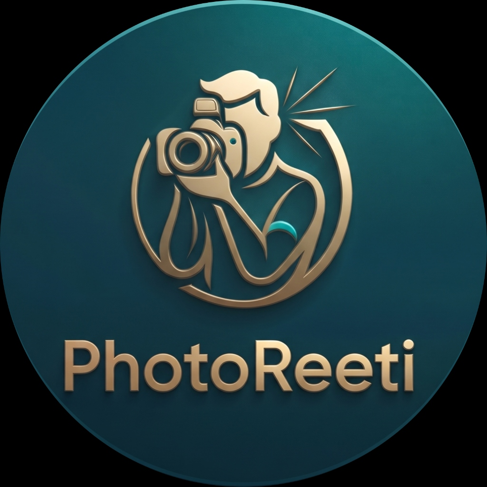

# PhotoReeti

> Direct Peer-to-Peer (P2P) Marketplace Connecting Clients Directly with Local Professional Photographers — No Intermediaries, True Artistic Freedom.



---

## 🌟 Key Features

- **Direct P2P Model**: Eliminates agency middlemen, allowing clients to negotiate quotes directly with local photographers.
- **Luxury Dark Mode Theme**: High-end petrol blue and dark teal background combined with metallic gold accents and glassmorphism.
- **Core Screens**:
  - **Splash & Onboarding Screen**: Featuring brand identity and dynamic role selection slider (*"I'm a Client"* vs *"I'm a Photographer"*).
  - **Explore / Home Screen**: Real-time location picker, aesthetic & gear search, trending categories, verified creator cards, and masonry photo grid.
  - **Creator Profile & Portfolio**: Equipment specs, performance stats, multi-genre portfolio, itemized pricing tiers, and client reviews.
  - **Direct Real-time Chat**: P2P messaging interface with itemized quote proposal cards, date locking, and instant replies.
  - **My Shoots & Milestones**: 5-stage milestone tracker (`Quote Accepted` → `Deposit Secured (20%)` → `Pre-Shoot Moodboard` → `Shoot Day` → `Final Gallery`) with escrow tracking.
  - **Floating Dock Navigation**: Glassmorphic bottom navigation bar with live notification badges.

---

## 🚀 Getting Started

### Prerequisites

- Node.js (v18 or higher)
- npm

### Installation

```bash
# Clone the repository
git clone https://github.com/nngandhi96/PhotoReeti.git

# Navigate to project directory
cd PhotoReeti

# Install dependencies
npm install

# Start local development server
npm run dev
```

### Production Build

```bash
npm run build
npm run preview
```

---

## 🛠️ Tech Stack

- **Framework**: Vite
- **Styling**: Vanilla CSS3 (Custom Glassmorphism, CSS Variables, Responsive Grid & Flexbox)
- **Icons**: Lucide Icons
- **Animation & Effects**: Canvas Confetti
- **Typography**: Google Fonts (Outfit & Plus Jakarta Sans)
